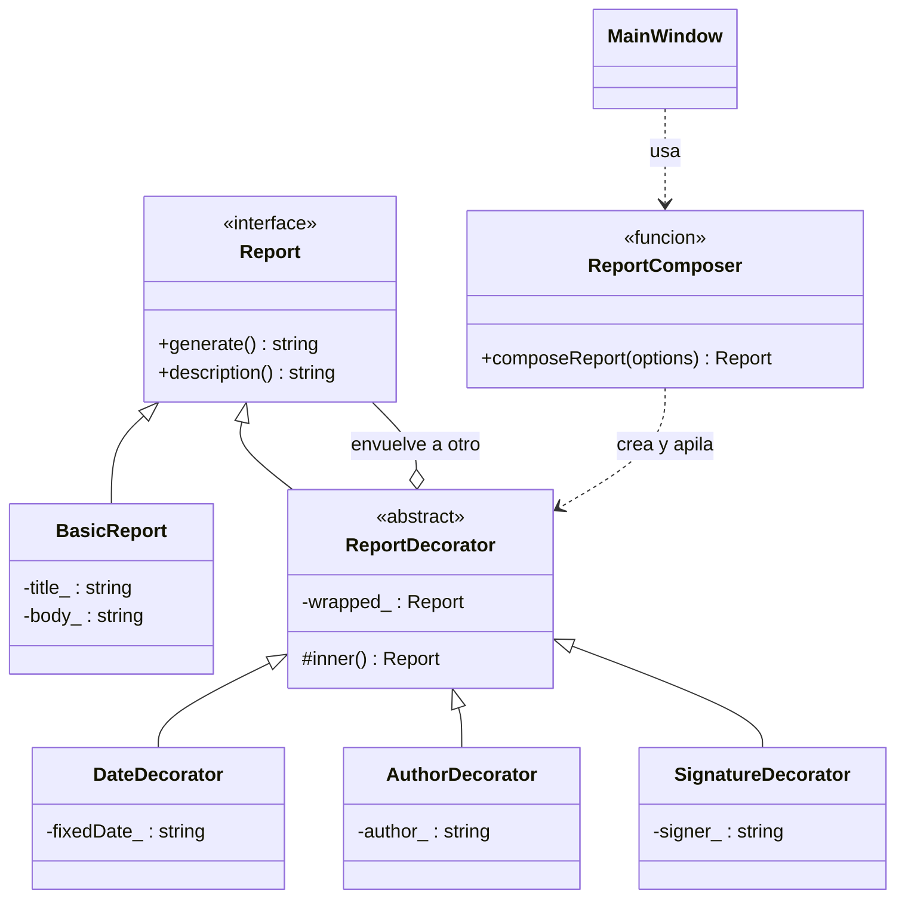

# Diagrama de clases

## Lectura del diagrama
- **Report** es la interfaz común: todo lo que se puede "generar" es un `Report`.
- **BasicReport** es el objeto original, sin funcionalidades extra.
- **ReportDecorator** es a la vez un `Report` (herencia) y **tiene** un `Report` (el que envuelve). Por eso se pueden apilar.
- **DateDecorator**, **AuthorDecorator** y **SignatureDecorator** agregan cada uno una sola funcionalidad.
- **composeReport** arma la cadena según lo que elija el usuario: `BasicReport -> Autor -> Fecha -> Firma`.